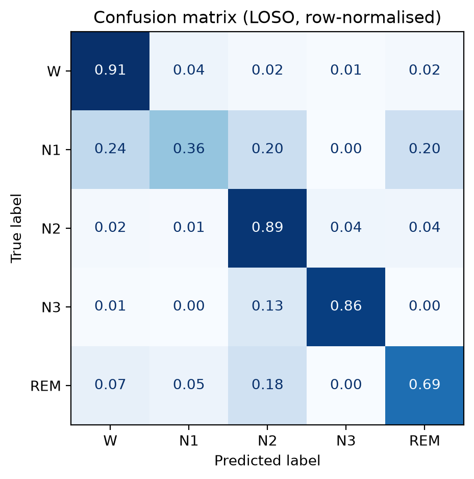
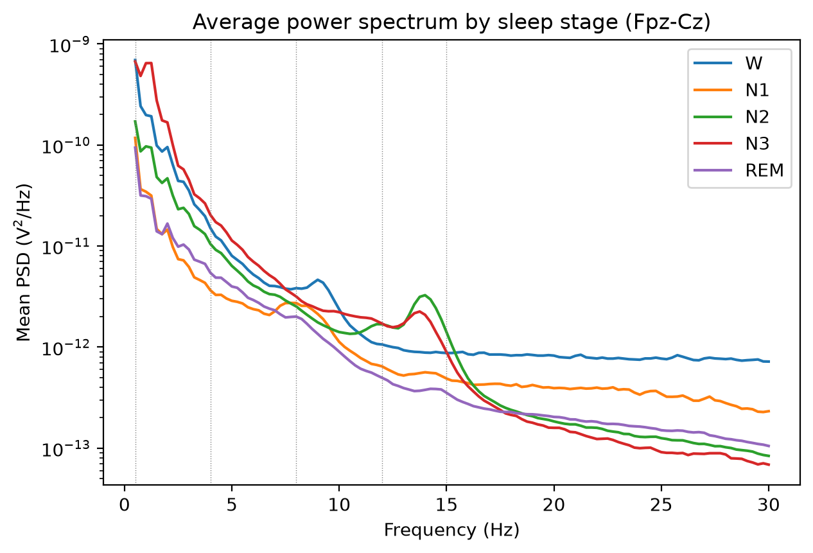
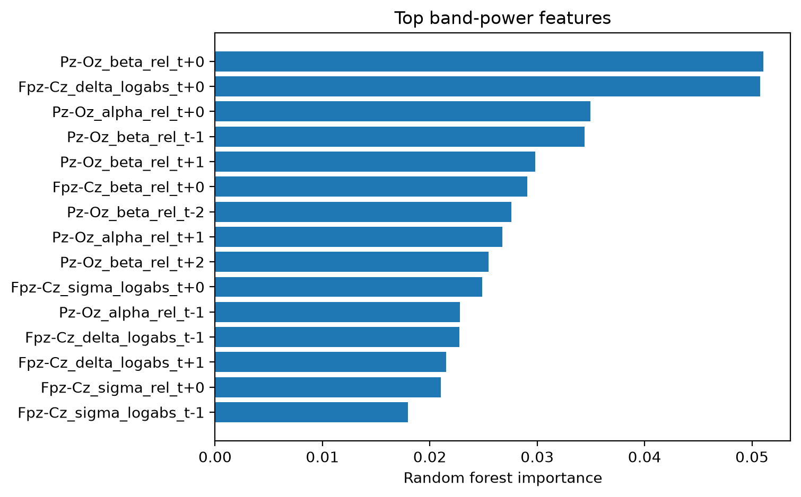

# Sleep stage classification from EEG (Sleep-EDF)

Classify 30-second EEG epochs into **W, N1, N2, N3, REM** using spectral features and
classical models, evaluated with **subject-wise cross-validation**.

> **Status:** pipeline implemented, unit-tested, and run on real data (first 10 Sleep-EDF
> cassette subjects, ids 0-9). This is a learning/portfolio project, not a novel method: sleep
> staging on Sleep-EDF is a well-studied benchmark.

## Key findings
- **Subject-wise accuracy is about 0.82** with neighbouring-epoch context (leave-one-subject-out,
  10 subjects: 0.821 ± 0.074 accuracy, kappa 0.745 ± 0.107).
- **A random epoch split inflates accuracy** from 0.819 (subject-wise) to 0.892, about 7 points.
- **N1 is the hardest stage** (F1 ≈ 0.44) and REM is next (F1 ≈ 0.73). The stages the model
  confuses are the ones whose average spectra overlap.
- **Context helps most subjects:** accuracy improved for 8 of 10 subjects, but dropped for one
  (subject 3).
- **Sanity check passed:** with shuffled labels, kappa falls to about 0 (-0.004), so the results
  are not caused by leakage between train and test subjects.

## Question this repo asks
Beyond building the pipeline, the repo quantifies **how much a random epoch split inflates
performance compared with a subject-wise split** (`leakage_demo` in the runner output).

## Data
[Sleep-EDF Expanded](https://physionet.org/content/sleep-edfx/1.0.0/) (PhysioNet), sleep-cassette
subset, subjects 0-9, night 1 only, EEG channels Fpz-Cz and Pz-Oz, 100 Hz, expert hypnograms.
Downloaded automatically via `mne.datasets.sleep_physionet`. Stages 3 and 4 are merged into N3.
Wake is cropped to 30 minutes before the first and after the last sleep epoch, which reduces the
share of wake and makes accuracies not directly comparable with papers that keep all wake.

9913 epochs in total: W 1760, N1 764, N2 4312, N3 1483, REM 1594.

## Pipeline
1. Band-pass 0.3-35 Hz, cut into 30 s epochs (`src/data.py`)
2. Features per channel (`src/features.py`): log band power (delta, theta, alpha, sigma, beta),
   relative power, delta/beta and theta/alpha ratios, Hjorth parameters, spectral entropy.
   Optional context: features of +-2 neighbouring epochs, within subject only.
3. Models (`src/models.py`): Random Forest, HistGradientBoosting (class-balanced)
4. Evaluation (`src/evaluate.py`): `GroupKFold` by subject; accuracy, macro-F1, Cohen's kappa,
   per-class F1, confusion matrix
5. Band-power analysis (`src/loso_eval.py`): a reduced feature set (Welch band power only) with
   leave-one-subject-out evaluation, per-subject results, a shuffled-label control, and plots

## Run
```bash
pip install -r requirements.txt
python scripts/run_baseline.py --subjects 0 1 2 3 4 5 6 7 8 9   # real data (needs internet)
python scripts/run_baseline.py --synthetic                      # pipeline check only, NOT real EEG

# band-power leave-one-subject-out analysis (results/loso_<options>/)
python src/loso_eval.py --subjects 0 1 2 3 4 5 6 7 8 9                      # single epoch
python src/loso_eval.py --subjects 0 1 2 3 4 5 6 7 8 9 --context 2          # with context
python src/loso_eval.py --subjects 0 1 2 3 4 5 6 7 8 9 --context 2 --balanced
python src/loso_eval.py --subjects 0 1 2 3 4 5 6 7 8 9 --shuffle            # sanity check

pytest -q tests
```
Outputs go to `results/` (metrics JSON, confusion matrices, leakage comparison, per-subject
tables, plots).

## Results
All results are on real Sleep-EDF recordings (10 subjects). Subject-wise means the test subject is
never seen during training.

### 1. Full feature set (`scripts/run_baseline.py`, subject-wise GroupKFold)

| Model | Features | Accuracy | Macro-F1 | Kappa |
|---|---|---|---|---|
| Random Forest | single epoch | 0.796 | 0.731 | 0.722 |
| Random Forest | + context | 0.819 | 0.767 | 0.752 |
| HistGradientBoosting | single epoch | 0.780 | 0.709 | 0.696 |
| HistGradientBoosting | + context | 0.815 | 0.757 | 0.745 |

Leakage demo (Random Forest + context): subject-wise accuracy **0.819** vs random epoch split
**0.892**.

### 2. Band-power features only (`src/loso_eval.py`, leave-one-subject-out)
Mean ± standard deviation across the 10 held-out subjects, Random Forest.

| Setup | Accuracy | Macro-F1 | Kappa |
|---|---|---|---|
| Single epoch | 0.790 ± 0.043 | 0.688 ± 0.084 | 0.698 ± 0.077 |
| + context ±2 epochs | 0.821 ± 0.074 | 0.729 ± 0.124 | 0.745 ± 0.107 |
| + context ±2, class-weighted | 0.805 ± 0.070 | 0.725 ± 0.113 | 0.727 ± 0.101 |
| Shuffled labels (control) | 0.417 ± 0.016 | 0.136 ± 0.011 | -0.004 ± 0.009 |

The shuffled-label accuracy equals the majority-class rate (N2 is 43.5% of epochs); kappa and
macro-F1 show that the model learns nothing from shuffled labels.

Pooled over all held-out epochs, band-power features with context reach 0.819 accuracy, the same
as the full feature set in table 1. The two use different cross-validation splits, so this is
not a controlled ablation, but it suggests the extra features add little on this data.

**Per-class results (band power + context ±2, pooled):**

| Stage | Precision | Recall | F1 |
|---|---|---|---|
| W | 0.805 | 0.915 | 0.857 |
| N1 | 0.575 | 0.361 | 0.444 |
| N2 | 0.852 | 0.892 | 0.872 |
| N3 | 0.871 | 0.862 | 0.867 |
| REM | 0.761 | 0.694 | 0.726 |



Class weighting raises N1 recall (0.36 to 0.45) but lowers N1 precision (0.58 to 0.43), leaves N1
F1 unchanged (0.44), and lowers overall accuracy, so the unweighted model is the main result.

### What the model uses


The average spectra show the expected structure: strongest slow-wave (delta) power in N3, an
alpha peak around 9 Hz in wake, a spindle peak at 13-14 Hz in N2. N1 and REM have similar spectra
at low frequencies, consistent with the N1/REM confusion in the matrix.



Top 15 band-power features by random forest importance (context ±2, fitted on all 10 subjects).
Importance is shared across correlated neighbouring-epoch features, so the ranking is descriptive
only and not a performance estimate. Relative high-frequency power can also reflect muscle
activity, not only cortical rhythms.

### Per-subject variability
Accuracy ranges from 0.64 to 0.90 across subjects (context ±2). Subject 3 is the weakest
(0.697 single epoch, 0.637 with context) and the only subject for which context clearly hurt
(subject 2 is flat). Subject 8 has acceptable accuracy (0.776) but low macro-F1 (about 0.54). The
causes were not investigated.

## Limitations
- Only 10 subjects, healthy sleep-cassette recordings, one night each; the standard deviations
  across subjects are noisy with n = 10
- Only two EEG channels; no EOG/EMG, which likely limits REM detection
- Hand-crafted features; no deep learning baseline yet
- Hyperparameters not tuned; no nested CV
- Wake cropping changes the class balance, so absolute numbers are not directly comparable with
  published results
- N1 recall is low (about 0.36), as in most sleep-staging work

## Ideas for next steps
Run all 20 subjects and both nights, investigate subjects 3 and 8, sleep spindle detection and age
effects, cross-dataset generalization, channel ablation (EEG vs EEG + EOG), a 1D-CNN baseline.
